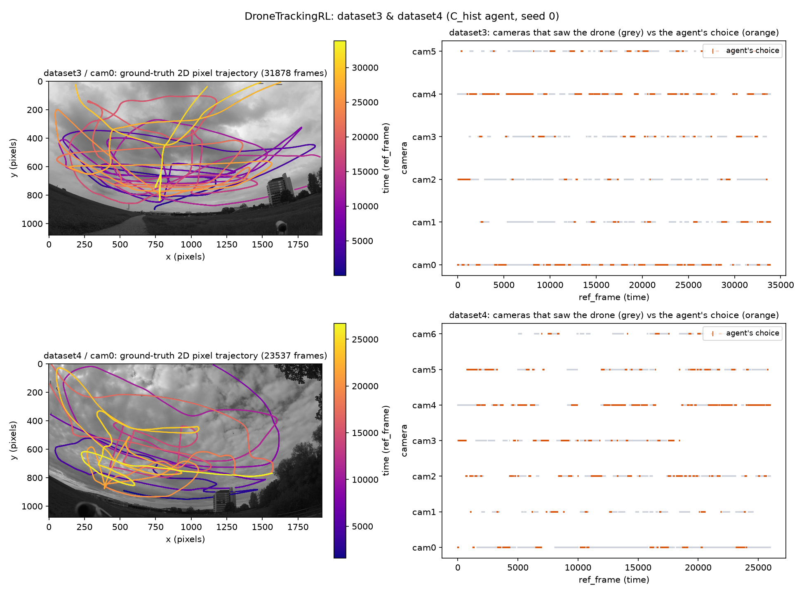
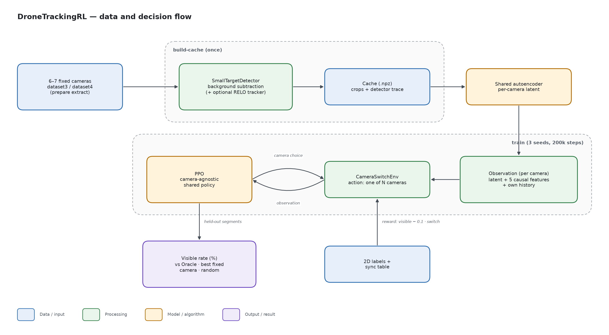
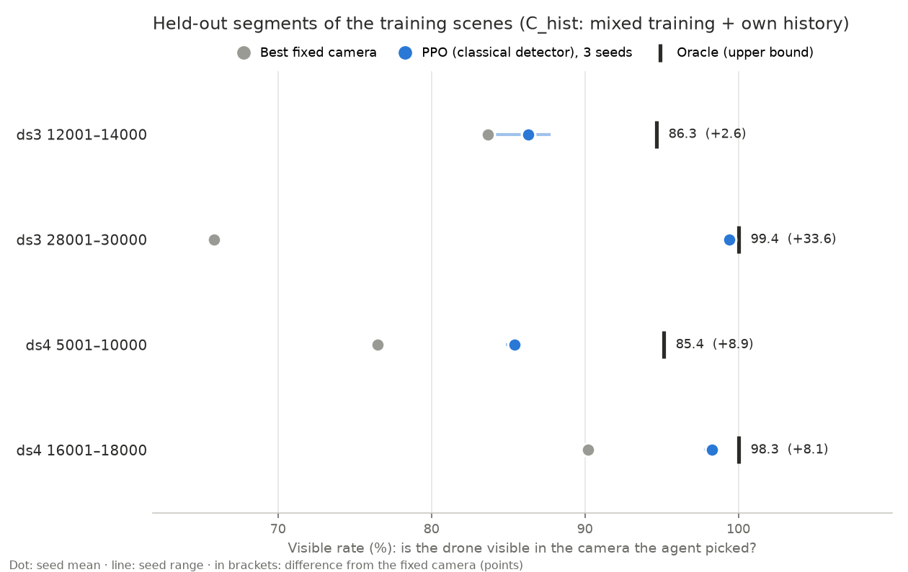
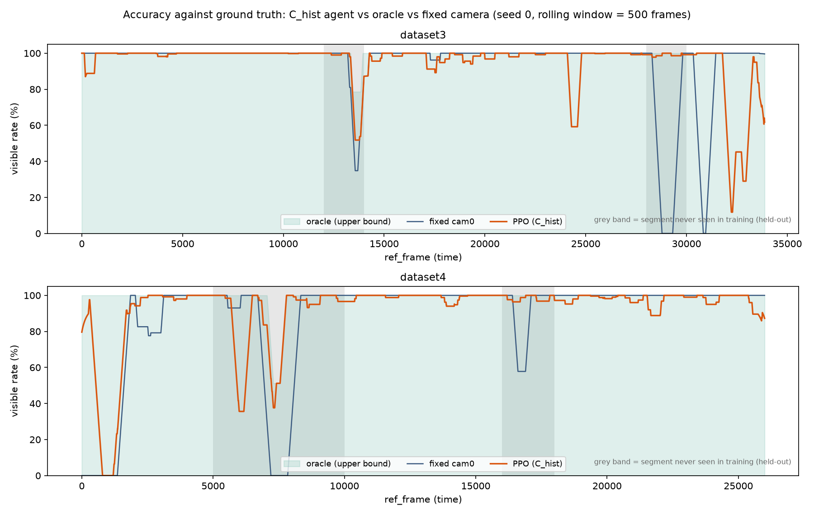
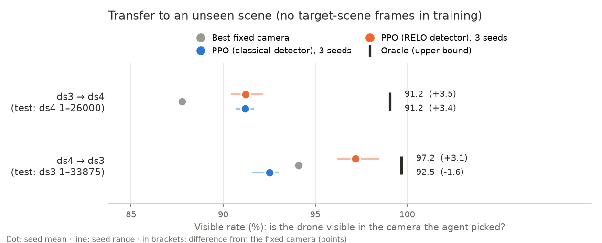

# DroneTrackingRL

**A reinforcement learning (PPO) agent that learns to pick, among fixed cameras looking from different angles, the one that currently shows a flying drone best.**

The same drone is watched by 6–7 fixed ground cameras. When the drone leaves the frame, goes behind an
obstacle or looks too small, the view has to switch to another camera. At every frame the agent looks at
features extracted per camera and decides which camera to switch to. The goal is to keep the drone visible on
screen for longer than the best fixed camera does. The agent is a "view selector", not a flight controller.
Data: ETH Zürich [drone-tracking-datasets](https://github.com/CenekAlbl/drone-tracking-datasets) (dataset3: 6 cameras, dataset4: 7 cameras).



*Left: the drone's ground-truth 2D trajectory in cam0. Right: which cameras saw the drone (grey) and the camera chosen by the C_hist agent (orange), dataset3 and dataset4, seed 0.*

## Overview

| | |
|---|---|
| **Problem** | Switching to the right camera in a multi-camera scene without losing the drone and without switching needlessly often. Metric: **visible rate**, the percentage of frames in which the drone is actually visible in the camera the agent picked. |
| **Method** | Small-target detector based on background subtraction (optionally hybrid with the RELO-T256 tracker), a per-camera latent from a shared autoencoder, 5 causal detector features and the agent's own history. A camera-agnostic shared PPO policy in a Gymnasium environment. Reward: visibility − 0.1 × camera switch. Baselines: Oracle, best fixed camera, random. |
| **Simulation / hardware** | No simulation; real multi-camera video. Training ran on CPU (PyTorch + Stable-Baselines3; Windows 11 and Ubuntu). 3 seeds × 200k steps per run (C_hist ~40 min). The RELO cache was produced on an RTX 5060 GPU. |
| **Paper** | In preparation (not yet written). |

### System architecture



Video frames are processed once and written to a small `.npz` cache. Training runs only from this cache, so
experiments repeat quickly. The policy is camera-agnostic, meaning every camera goes through the same network.
This lets an agent trained on the 6-camera scene also run on the 7-camera scene.

## Selected results

### Result 1: On unseen segments of the same scenes the agent beats the fixed camera

In all 4 segments never used in training, PPO is above the best fixed camera (by +2.6 to +33.6 points). In the
ds3 28001–30000 segment, where switching cameras really matters, the fixed camera stays at 65.8% while the agent
reaches the oracle (99.4%). Note: the "best fixed camera" is picked by looking at the test data, so it is an
optimistic baseline against the agent.



### Result 2: Own history and a switch penalty cut camera switches by 28–118×

The previous agent switched cameras almost every 3–5 frames, reacting to the detector's frame-to-frame jitter.
Adding "which camera was I just on, and for how many steps" to the observation plus a small switch penalty makes
the agent switch only every ~150–380 frames. Accuracy stayed the same or improved (ds4 16001–18000: 94.8 → 98.3).
The curve below shows the rolling-window visible rate compared with the oracle and the fixed cam0.



### Result 3: Transfer to a new scene is inconsistent; the RELO detector gives a clear gain in one direction

With no target-scene frames in training, the classical detector gains +3.4 points in the ds3 → ds4 direction,
while in the ds4 → ds3 direction the agent stays below the fixed camera (−1.6). A cache built with the
RELO-T256 tracker turns ds4 → ds3 into +3.1. The ablation shows this gain comes from RELO locating the drone
better, not from the RELO features added to the observation. The gain of mixed (both scenes together) training
on the first split did not replicate on a second split (Fold B). Details, including failed attempts:
[EXPERIMENTS.md](EXPERIMENTS.md) (in Turkish).



*All figures are in `plots/`; the numbers come from `results/*/results.json` and `summary.txt`.*

## Installation

### Requirements

- Windows 10/11 or Linux, Python ≥ 3.10 (tested with 3.12)
- RAM ≥ 8 GB (training uses ~5–6 GB). No GPU needed for training; producing the RELO cache needs a CUDA GPU.
- ~65 GB free disk (dataset3 frames ~24 GB, dataset4 ~30 GB)

### Steps

```bash
git clone https://github.com/BalBaZeuR0/Drone-Tracking.git
cd Drone-Tracking
python -m venv .venv && source .venv/bin/activate      # Windows: .venv\Scripts\Activate.ps1
pip install -r requirements-lock.txt
pip install -e ".[dev,plots]"
python -m pytest -q                                     # installation check
```

Expected output:

```
109 passed, 1 skipped in 75.98s (0:01:15)
```

Data preparation (frame extraction, cache building, checks) is described step by step in [RUN_ON_OTHER_PC.md](RUN_ON_OTHER_PC.md) (in Turkish).

## Usage

### Extract frames, build the cache, check it

```bash
python -m dronetrackingrl.real_data.prepare extract --dataset-dir DATA/dataset3 --frames-dir WORK/dataset3_frames --work-dir WORK/tmp --workers 3
python -m dronetrackingrl.real_data.experiment build-cache --sync dataset3 --workers 4 --cameras 0 1 2 3 4 5 \
    --frames-root WORK/dataset3_frames --detections-dir DATA/dataset3/detections --ref-start 1 --ref-end 33875 \
    --parts-dir WORK/parts3 --out caches/dataset3_full.npz
python -m dronetrackingrl.real_data.experiment inspect-cache caches/dataset3_full.npz
```

### Train the C_hist agent (mixed training + own history + switch penalty)

```bash
python -m dronetrackingrl.real_data.experiment train \
    --train-cache caches/dataset3_full.npz --train-range 1 11800 \
    --extra-train caches/dataset3_full.npz:14200:27800 caches/dataset3_full.npz:30201:33875 \
                  caches/dataset4_full.npz:1:4800 caches/dataset4_full.npz:10201:15800 caches/dataset4_full.npz:18201:26000 \
    --eval-cache caches/dataset3_full.npz --eval-range 12001 14000 \
    --extra-eval caches/dataset3_full.npz:28001:30000 caches/dataset4_full.npz:5001:10000 caches/dataset4_full.npz:16001:18000 \
    --obs-mode latent+aux --include-own-history --switch-penalty 0.1 \
    --timesteps 200000 --seeds 0 1 2 --encoder-epochs 5 --out-dir outputs/C_hist
```

Expected output (`outputs/C_hist/summary.txt`, first held-out segment; the CLI writes its summary in Turkish:
oracle visible rate, random, best fixed camera, PPO with 3 seeds):

```
=== EVAL (ref_frame 12001..14000, 1999 adım) ===
  En iyi mümkün (oracle) görünür oranı : 0.9465
  Rastgele                             : 0.4487 ± 0.0048
  En iyi sabit kamera (cam0)      : 0.8369
  PPO (3 seed)                        : 0.8629 ± 0.0154   (seed başına: 0.8769, 0.8704, 0.8414)
```

Summaries of all earlier runs are in `results/<run>/summary.txt`, and the experiment ledger is `results/ledger.csv`.

## Reproducing the results

| Figure | Command |
|---|---|
| `plots/same_scene_heldout.png`, `plots/new_scene.png` | `python scripts/plot_readme.py` (from the saved `results/` files) |
| `assets/camera_selection.png`, `plots/visible_rate_over_time.png` | `python scripts/plot_traces.py --trace-dir outputs/C_hist/seed_0 --data-dir DATA` (from the C_hist run's per-step trace files) |
| `results/C_hist/*` | The "Train the C_hist agent" command above |
| `results/X_ds4_to_ds3_relo_ozelliksiz/*` | `bash scripts/relo_ablation.sh` (needs the RELO cache) |
| `assets/architecture.png` | `python scripts/flowchart.py assets/architecture.json` |

## Project structure

```
Drone-Tracking/
├── assets/              # README images (camera_selection.png, architecture.png + .json source)
├── caches/              # .npz caches (not committed, reproducible)
├── docs/                # design documents and implementation plans
├── plots/               # result figures
├── results/             # results.json + summary.txt of every experiment, ledger.csv
├── scripts/             # RELO chains, diagnostic scripts, plot_readme.py, plot_traces.py, flowchart.py
├── src/dronetrackingrl/
│   ├── masking/         # SmallTargetDetector, RELO hybrid tracker
│   ├── encoder/         # shared autoencoder
│   ├── rl_env/          # CameraSwitchEnv (Gymnasium)
│   ├── baselines/       # Oracle / fixed camera / random
│   ├── real_data/       # frame extraction, sync, cache, training CLI
│   └── evaluation/      # visible rate and logging
├── tests/               # 110 tests (+ small frame samples)
├── EXPERIMENTS.md       # every experiment, failed ones included (in Turkish)
├── RUN_ON_OTHER_PC.md   # step-by-step setup and training on another machine (in Turkish)
├── pyproject.toml
└── README.md
```

## Citation, license, contact

```bibtex
@misc{dronetrackingrl2026,
  title  = {DroneTrackingRL: Camera selection with reinforcement learning for multi-camera drone tracking},
  author = {Öztürk, Emir},
  year   = {2026},
  howpublished = {\url{https://github.com/BalBaZeuR0/Drone-Tracking}}
}
```

Data: [CenekAlbl/drone-tracking-datasets](https://github.com/CenekAlbl/drone-tracking-datasets). Training monitoring: [rlpanel](https://github.com/BalBaZeuR0/RLpanel).
No license file has been added yet; please get in touch before reusing the code.
Contact: [@BalBaZeuR0](https://github.com/BalBaZeuR0), MTA Artificial Intelligence Center.
