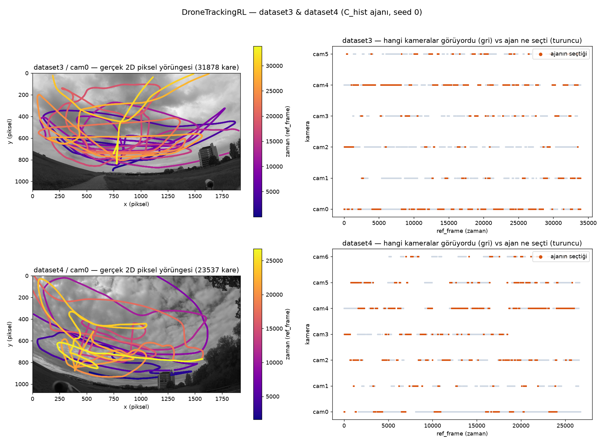
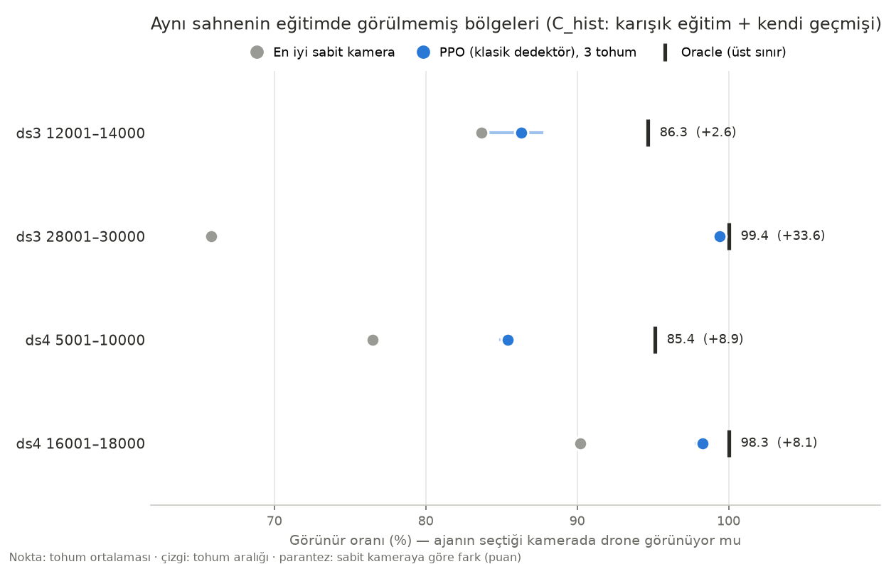
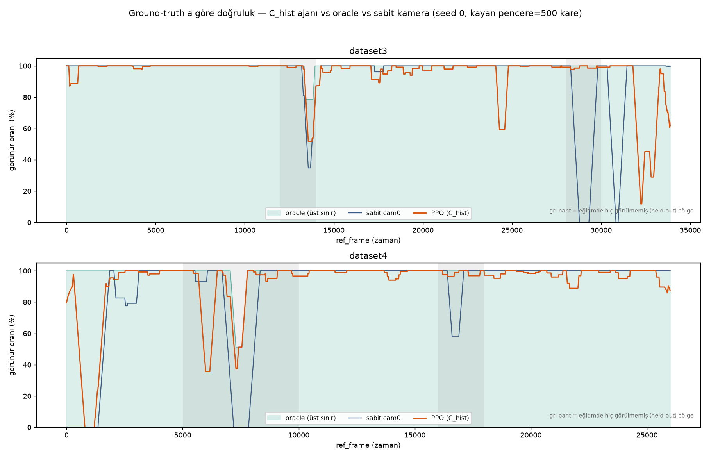
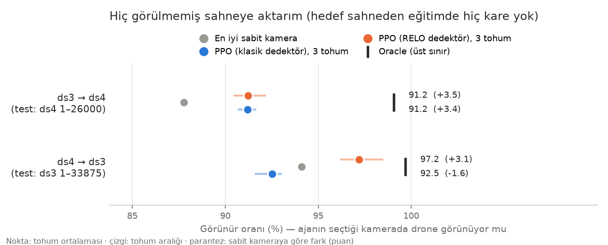

# DroneTrackingRL

**Farklı açılardan bakan sabit kameralar arasında, uçan drone'u o an en iyi gösteren kamerayı seçmeyi öğrenen bir pekiştirmeli öğrenme (PPO) ajanı.**

Aynı drone'u 6–7 sabit yer kamerası izliyor. Drone kadrajdan çıktığında, bir engelin arkasına girdiğinde
ya da çok küçük göründüğünde başka bir kameraya geçmek gerekiyor. Ajan her karede kamera başına çıkarılan
özelliklere bakarak hangi kameraya geçeceğine karar veriyor. Hedef, drone'un ekranda görünür kaldığı
süreyi en iyi sabit kameradan daha uzun tutmak. Bu ajan uçuş kontrolcüsü değil, bir "görüntü seçici".
Veri: ETH Zürich [drone-tracking-datasets](https://github.com/CenekAlbl/drone-tracking-datasets) (dataset3: 6 kamera, dataset4: 7 kamera).



*Solda drone'un cam0'daki gerçek 2D yörüngesi; sağda hangi kameraların drone'u gördüğü (gri) ve C_hist ajanının seçtiği kamera (turuncu), dataset3 ve dataset4, tohum 0.*

## Özet

| | |
|---|---|
| **Problem** | Çok kameralı sahnede drone'u kaybetmeden, gereksiz sık geçiş yapmadan doğru kameraya geçmek. Ölçüt: **görünür oranı**, yani ajanın seçtiği kamerada drone'un o karede gerçekten görünme yüzdesi. |
| **Yöntem** | Arka plan çıkarmaya dayalı küçük hedef dedektörü (isteğe bağlı RELO-T256 takipçisiyle hibrit), ortak otokodlayıcı ile kamera başına latent, 5 nedensel dedektör özelliği ve ajanın kendi geçmişi. Gymnasium ortamında kameradan bağımsız ortak PPO politikası. Ödül: görünürlük − 0,1 × kamera geçişi. Kıyaslar: Oracle, en iyi sabit kamera, rastgele. |
| **Simülasyon / donanım** | Simülasyon yok, gerçek çok kameralı video. Eğitim CPU'da yapıldı (PyTorch + Stable-Baselines3; Windows 11 ve Ubuntu). Koşu başına 3 tohum × 200k adım (C_hist ~40 dk). RELO önbelleği RTX 5060 GPU'da üretildi. |
| **Makale** | Hazırlanıyor (henüz yazılmadı). |

### Sistem mimarisi


Video kareleri bir kez işlenip küçük bir `.npz` önbelleğe yazılır. Eğitim yalnızca bu önbellekten çalıştığı
için deneyler hızlı tekrarlanır. Politika kameradan bağımsızdır, yani her kamera aynı ağdan geçer. Bu sayede
6 kameralı sahnede eğitilen ajan 7 kameralı sahnede de çalışabilir.

## Seçilmiş sonuçlar

### Sonuç 1: Aynı sahnenin görülmemiş bölgelerinde ajan sabit kamerayı geçiyor

Eğitimde hiç kullanılmamış 4 bölgenin hepsinde PPO en iyi sabit kameranın üstünde (+2,6 ile +33,6 puan arası).
Kamera değiştirmenin gerçekten önemli olduğu ds3 28001–30000 bölgesinde sabit kamera %65,8'de kalırken ajan
oracle'a ulaşıyor (%99,4). Not: "en iyi sabit kamera" test verisine bakılarak seçildiği için ajana karşı iyimser bir ölçüttür.



### Sonuç 2: Kendi geçmişi ve geçiş cezası, kamera değiştirme sayısını 28–118 kat azaltıyor

Önceki ajan neredeyse her 3–5 karede bir kamera değiştiriyordu; dedektörün kare kare titremesine tepki
veriyordu. Gözleme "az önce hangi kameradaydım, kaç adımdır oradayım" bilgisi ve küçük bir geçiş cezası
eklenince ajan artık ~150–380 karede bir değiştiriyor. Doğruluk aynı kaldı ya da arttı (ds4 16001–18000: 94,8 → 98,3).
Aşağıdaki eğri, oracle ve sabit cam0 ile karşılaştırmalı kayan pencere görünür oranını gösteriyor.



### Sonuç 3: Yeni sahneye aktarım tutarsız; RELO dedektörü bir yönde net kazanç sağlıyor

Hedef sahneden eğitimde hiç kare yokken klasik dedektörle ds3 → ds4 yönünde +3,4 puan kazanç var, ds4 → ds3
yönünde ise ajan sabit kameranın altında kalıyor (−1,6). RELO-T256 takipçisiyle üretilen önbellek ds4 → ds3
yönünü +3,1'e çeviriyor. Ablasyona göre bu kazanç RELO'nun daha iyi konum bulmasından geliyor, gözleme eklenen
RELO özelliklerinden değil. Karışık (iki sahne birlikte) eğitimin ilk bölünmedeki kazancı ikinci bir bölünmede
tekrarlanmadı (Fold B). Ayrıntılar, başarısız denemeler dahil: [EXPERIMENTS.md](EXPERIMENTS.md).



*Tüm şekiller `plots/` klasöründe; sayıların kaynağı `results/*/results.json` ve `summary.txt`.*

## Kurulum

### Gereksinimler

- Windows 10/11 veya Linux, Python ≥ 3.10 (3.12 ile test edildi)
- RAM ≥ 8 GB (eğitim ~5–6 GB). Eğitim için GPU gerekmez; RELO önbelleğini üretmek için CUDA'lı GPU gerekir.
- ~65 GB boş disk (dataset3 kareleri ~24 GB, dataset4 ~30 GB)

### Adımlar

```bash
git clone https://github.com/BalBaZeuR0/Drone-Tracking.git
cd Drone-Tracking
python -m venv .venv && source .venv/bin/activate      # Windows: .venv\Scripts\Activate.ps1
pip install -r requirements-lock.txt
pip install -e ".[dev,plots]"
python -m pytest -q                                     # kurulum kontrolü
```

Beklenen çıktı:

```
109 passed, 1 skipped in 75.98s (0:01:15)
```

Veri hazırlığı (kare çıkarma, önbellek üretme, kontrol) adım adım [RUN_ON_OTHER_PC.md](RUN_ON_OTHER_PC.md) dosyasında anlatılıyor.

## Kullanım

### Kareleri çıkar, önbellek üret, kontrol et

```bash
python -m dronetrackingrl.real_data.prepare extract --dataset-dir DATA/dataset3 --frames-dir WORK/dataset3_frames --work-dir WORK/tmp --workers 3
python -m dronetrackingrl.real_data.experiment build-cache --sync dataset3 --workers 4 --cameras 0 1 2 3 4 5 \
    --frames-root WORK/dataset3_frames --detections-dir DATA/dataset3/detections --ref-start 1 --ref-end 33875 \
    --parts-dir WORK/parts3 --out caches/dataset3_full.npz
python -m dronetrackingrl.real_data.experiment inspect-cache caches/dataset3_full.npz
```

### C_hist ajanını eğit (karışık eğitim + kendi geçmişi + geçiş cezası)

```bash
python -m dronetrackingrl.real_data.experiment train \
    --train-cache caches/dataset3_full.npz --train-range 1 11800 \
    --extra-train caches/dataset3_full.npz:14200:27800 caches/dataset3_full.npz:30201:33875 \
                  caches/dataset4_full.npz:1:4800 caches/dataset4_full.npz:10201:15800 caches/dataset4_full.npz:18201:26000 \
    --eval-cache caches/dataset3_full.npz --eval-range 12001 14000 \
    --extra-eval caches/dataset3_full.npz:28001:30000 caches/dataset4_full.npz:5001:10000 caches/dataset4_full.npz:16001:18000 \
    --obs-mode latent+aux --include-own-history --switch-penalty 0.1 \
    --timesteps 200000 --seeds 0 1 2 --encoder-epochs 5 --out-dir outputs/C_hist
```

Beklenen çıktı (`outputs/C_hist/summary.txt`, ilk held-out bölge):

```
=== EVAL (ref_frame 12001..14000, 1999 adım) ===
  En iyi mümkün (oracle) görünür oranı : 0.9465
  Rastgele                             : 0.4487 ± 0.0048
  En iyi sabit kamera (cam0)      : 0.8369
  PPO (3 seed)                        : 0.8629 ± 0.0154   (seed başına: 0.8769, 0.8704, 0.8414)
```

Önceki tüm koşuların özetleri `results/<koşu>/summary.txt` dosyalarında, deney defteri `results/ledger.csv` dosyasında.

## Sonuçları yeniden üretme

| Şekil | Komut |
|---|---|
| `plots/ayni_sahne_heldout.png`, `plots/yeni_sahne.png` | `python scripts/plot_readme.py` (kayıtlı `results/` dosyalarından) |
| `assets/kamera_secimi.png`, `plots/ground_truth_dogruluk_karsilastirmasi.png` | C_hist koşusunun adım adım iz dosyalarından (`outputs/C_hist/seed_0/trace_*.csv`) üretildi |
| `results/C_hist/*` | Yukarıdaki "C_hist ajanını eğit" komutu |
| `results/X_ds4_to_ds3_relo_ozelliksiz/*` | `bash scripts/relo_ablation.sh` (RELO önbelleği gerekir) |
| `assets/architecture.png` | `python scripts/flowchart.py assets/architecture.json` |

## Proje yapısı

```
Drone-Tracking/
├── assets/              # README görselleri (kamera_secimi.png, architecture.png + .json kaynağı)
├── caches/              # .npz önbellekler (git'e alınmaz, yeniden üretilebilir)
├── docs/                # tasarım belgeleri ve uygulama planları
├── plots/               # sonuç grafikleri
├── results/             # her deneyin results.json + summary.txt kaydı, ledger.csv
├── scripts/             # RELO zincirleri, teşhis betikleri, plot_readme.py, flowchart.py
├── src/dronetrackingrl/
│   ├── masking/         # SmallTargetDetector, RELO hibrit takipçi
│   ├── encoder/         # ortak otokodlayıcı
│   ├── rl_env/          # CameraSwitchEnv (Gymnasium)
│   ├── baselines/       # Oracle / sabit kamera / rastgele
│   ├── real_data/       # kare çıkarma, senkron, önbellek, eğitim CLI'ı
│   └── evaluation/      # görünür oranı ve kayıt
├── tests/               # 110 test (+ küçük kare örnekleri)
├── EXPERIMENTS.md       # tüm deneyler, başarısızlar dahil
├── RUN_ON_OTHER_PC.md   # başka makinede adım adım kurulum ve eğitim
├── pyproject.toml
└── README.md
```

## Atıf, lisans, iletişim

```bibtex
@misc{dronetrackingrl2026,
  title  = {DroneTrackingRL: Çok kameralı drone takibi için pekiştirmeli öğrenmeyle kamera seçimi},
  author = {Öztürk, Emir},
  year   = {2026},
  howpublished = {\url{https://github.com/BalBaZeuR0/Drone-Tracking}}
}
```

Veri: [CenekAlbl/drone-tracking-datasets](https://github.com/CenekAlbl/drone-tracking-datasets). Eğitim izleme: [rlpanel](https://github.com/BalBaZeuR0/RLpanel).
Lisans dosyası henüz eklenmedi, kullanım için iletişime geçin.
İletişim: [@BalBaZeuR0](https://github.com/BalBaZeuR0), MTA Yapay Zeka Merkezi.
